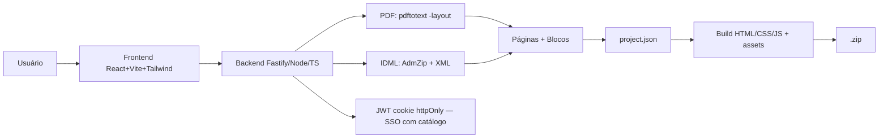

# Arquitetura — Portal Interativo

## Visão geral

Aplicação web que converte livros didáticos (PDF / IDML / INDD) em **projetos web interativos** compostos por páginas e blocos editáveis, com exportação em build estático (`.zip`).

## Pipeline de conversão

### PDF
1. `pdftotext -layout -enc UTF-8 arquivo.pdf -` extrai o texto preservando a quebra de páginas (`\f`).
2. O texto é dividido por `\f` — **1 página física = 1 página do projeto** (corrige o agrupamento artificial por linhas).
3. Cada página é decomposta em blocos: grupos de linhas separados por linha em branco viram parágrafos; linhas curtas em caixa alta/final ":" viram títulos.
4. Imagens JPEG nativas (`/Filter /DCTDecode`) são extraídas para `assets/`.
5. Fallback: se `pdftotext` não estiver disponível/falhar, usa o parser nativo de streams (`zlib.inflateSync`).

### IDML
1. `AdmZip` abre o pacote (ZIP).
2. `Stories/Story_*.xml` → parágrafos e títulos (`ParagraphStyleRange` + `Content`).
3. `Spreads/Spread_*.xml` → vínculo `ParentStory` (texto) e `LinkResourceURI` (imagens).
4. Mídias embutidas (`Resources/`) e links relativos (`Links/`) são copiados para `assets/`.
5. **Página do projeto = spread real** (pendente T4/T5: remover o agrupamento por 8 parágrafos do fallback).

### INDD
Binário proprietário; não é parseado. A UI orienta exportar para **IDML** ou **PDF** no InDesign.

## Modelo de dados

`project.json`:
- `pages[]` — `{ id, pageNumber, title, blocks[] }`
- `blocks[]` — `heading`, `paragraph`, `image`, `accordion`, `tabs`, `callout`, `video`, `quiz`, `external-embed`
- `assets[]` — `{ id, fileName, path, mimeType, altText }`

## Referência de conteúdo real
O relatório `docs/RELATORIO_ANALISE_ARQUIVOS.md` mapeia 9 arquivos (1 PDF, 7 IDML, 2 INDD), 80 páginas, 746 blocos e 78 mídias. Ele é a base para calibrar a extração: títulos, seções pedagógicas (`MEU REPERTÓRIO`, `FAÇA VOCÊ MESMO`, `PARA AMPLIAR SABERES`) e ícones de interação (`00-video_filme_*.ai`, `podcast_audio.ai`, `link_clicável_1.ai`).

## Portas
- Backend: 3002
- Frontend: 5173
- Catálogo (SSO): backend 3001

## Decisões (ADRs)
- **Paginação por `pdftotext`** em vez de agrupar linhas: fidelidade ao original e contagem correta.
- **SSO por cookie httpOnly** compartilhado com o catálogo.
- **Build estático** (HTML/CSS/JS) para portabilidade do `.zip`.
