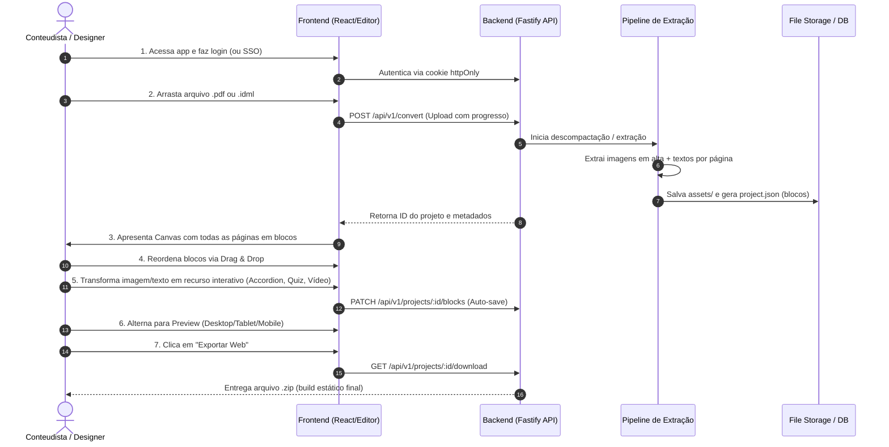

# Planejamento & Arquitetura — Sistema Interativo (Conversor de Livros em Blocos Web)

> **Documento de Especificação Técnica e Tomadas de Decisão de Arquitetura (ADRs)**  
> **Versão:** 1.0.0  
> **Status:** Aprovado para Implementação  
> **Data:** Novembro/2026  

---

## 1. Visão Geral do Produto

O **Interativo** é uma plataforma web para transformar materiais didáticos e editoriais estáticos (apostilas, livros didáticos, fascículos em formatos `.pdf`, `.idml` do Adobe InDesign) em **experiências digitais interativas, responsivas e acessíveis (HTML5/Web)**.

### O Problema Atual
Os materiais chegam do setor editorial diagramados em InDesign ou fechados em PDF de alta resolução. Esses materiais:
- São pesados e pouco responsivos em telas de smartphones e tablets;
- Não possuem elementos interativos nativos (sanfonas, abas, perguntas com feedback imediato, vídeos embutidos, zoom de imagens);
- Exigem retrabalho manual gigantesco caso uma equipe precise recriá-los do zero para a web.

### A Solução Proposta
Uma plataforma em que o conteudista ou designer educacional realiza:
1. **Login unificado** na aplicação;
2. **Upload do arquivo original** (`.pdf` ou `.idml` exportado do InDesign);
3. **Extração e Renderização Automática** de todas as páginas, separando textos, imagens originais e hierarquias;
4. **Conversão em Blocos Editáveis**: o conteúdo vira blocos semânticos (títulos, parágrafos, caixas de destaque, imagens);
5. **Editor Drag & Drop (Estilo WordPress Gutenberg / Elementor)**: facilidade para reorganizar páginas e blocos, trocar ou enriquecer imagens com links e modais de zoom, transformar textos em sanfonas ou abas, adicionar vídeos e quizzes interativos;
6. **Preview em tempo real** e **Exportação de Pacote Web (.zip)** autônomo, leve e pronto para qualquer servidor ou Ambiente Virtual de Aprendizagem (AVA/Moodle).

---

## 2. Jornada do Usuário (Passo a Passo)



### Detalhamento das Etapas:

1. **Autenticação:** O usuário acessa a plataforma e faz login com suas credenciais ou via SSO (compartilhado com `catalogo-recursos`), garantindo permissões seguras.
2. **Upload & Análise Inicial:** O usuário faz upload de um `.pdf` ou `.idml`. O sistema exibe barra de progresso real e validações de integridade. (Para arquivos `.indd`, exibe alerta orientando exportação para IDML).
3. **Renderização de Páginas:** O sistema abre o projeto exibindo:
   - Navegador de páginas à esquerda (thumbnails das páginas 1 a N);
   - Área central (canvas) com a página selecionada já decomposta em blocos (Título, Parágrafo, Imagem, etc.);
   - Banco de mídias extraídas (todas as fotos, ilustrações e ícones detectados no arquivo).
4. **Edição Visual & Drag & Drop:**
   - O usuário pode arrastar blocos para reorganizar a ordem de leitura.
   - Pode clicar em qualquer texto para editar ortografia, mudar peso ou formatar.
   - Pode arrastar imagens da biblioteca para dentro dos blocos ou substituir uma imagem antiga.
5. **Enriquecimento com Recursos Interativos:**
   - Trocar uma imagem estática por um **Carrossel** ou **Imagem com Zoom/Lupa**;
   - Converter uma lista de tópicos em uma **Sanfona (Accordion)** ou **Abas (Tabs)**;
   - Adicionar uma **Caixa de Destaque / Saiba Mais**;
   - Inserir um **Vídeo incorporado** (YouTube, Vimeo ou MP4) ou **Link Externo com card interativo**;
   - Adicionar **Atividade / Quiz de fixação** com perguntas e feedback de resposta imediato;
   - Inserir **Objeto Embed Interativo** (simuladores PhET, H5P, Genially).
6. **Preview & Validação:** Visualização instantânea em resolução de Desktop, Tablet e Celular, além de auditoria básica de contraste e acessibilidade (leitor de tela).
7. **Exportação:** Geração de um arquivo `.zip` autônomo contendo `index.html`, `styles.css`, `script.js` e a pasta `assets/`, funcionando sem qualquer servidor backend (offline-first).

---

## 3. Arquitetura de Dados: Estrutura em Blocos (`project.json`)

Para desacoplar a edição da geração de HTML, o estado central de cada projeto é mantido em uma estrutura declarativa e tipada em JSON.

### Esquema do Documento (`project.json`)

```typescript
export interface ProjectDocument {
  id: string;
  title: string;
  sourceFormat: "PDF" | "IDML";
  createdAt: string;
  updatedAt: string;
  theme: {
    primaryColor: string;
    fontFamily: string;
    mode: "light" | "dark" | "high-contrast";
  };
  assets: ProjectAsset[];
  pages: ProjectPage[];
}

export interface ProjectAsset {
  id: string;
  fileName: string;
  path: string; // Ex: assets/img_001.png
  mimeType: string;
  width?: number;
  height?: number;
  altText: string;
}

export interface ProjectPage {
  id: string;
  pageNumber: number;
  title?: string;
  blocks: Block[];
}

export type BlockType =
  | "heading"
  | "paragraph"
  | "image"
  | "accordion"
  | "tabs"
  | "callout"
  | "quote"
  | "gallery"
  | "video"
  | "quiz"
  | "external-embed";

export interface BaseBlock {
  id: string;
  type: BlockType;
  settings?: {
    align?: "left" | "center" | "right";
    backgroundColor?: string;
    padding?: "sm" | "md" | "lg";
  };
}

export interface HeadingBlock extends BaseBlock {
  type: "heading";
  data: {
    level: 1 | 2 | 3 | 4 | 5 | 6;
    text: string;
  };
}

export interface ParagraphBlock extends BaseBlock {
  type: "paragraph";
  data: {
    html: string; // Rich text formatado (negrito, itálico, links)
  };
}

export interface ImageBlock extends BaseBlock {
  type: "image";
  data: {
    src: string;
    alt: string;
    caption?: string;
    enableZoom?: boolean;
    linkUrl?: string;
  };
}

export interface AccordionBlock extends BaseBlock {
  type: "accordion";
  data: {
    items: Array<{
      id: string;
      title: string;
      contentHtml: string;
      defaultOpen?: boolean;
    }>;
  };
}

export interface TabsBlock extends BaseBlock {
  type: "tabs";
  data: {
    items: Array<{
      id: string;
      label: string;
      contentHtml: string;
    }>;
  };
}

export interface CalloutBlock extends BaseBlock {
  type: "callout";
  data: {
    variant: "info" | "tip" | "warning" | "curiosity";
    title?: string;
    contentHtml: string;
  };
}

export interface VideoBlock extends BaseBlock {
  type: "video";
  data: {
    source: "youtube" | "vimeo" | "local";
    url: string;
    title?: string;
    caption?: string;
  };
}

export interface QuizBlock extends BaseBlock {
  type: "quiz";
  data: {
    question: string;
    options: Array<{
      id: string;
      text: string;
      isCorrect: boolean;
      feedback?: string;
    }>;
    explanation?: string;
  };
}

export interface ExternalEmbedBlock extends BaseBlock {
  type: "external-embed";
  data: {
    embedUrl: string;
    title?: string;
    aspectRatio?: "16/9" | "4/3" | "square";
  };
}

export type Block =
  | HeadingBlock
  | ParagraphBlock
  | ImageBlock
  | AccordionBlock
  | TabsBlock
  | CalloutBlock
  | VideoBlock
  | QuizBlock
  | ExternalEmbedBlock;
```

---

## 4. Arquitetura do Editor Frontend

A interface do editor é construída em **React 18** com **Tailwind CSS** e **@dnd-kit**, projetada nos seguintes módulos visuais:

```
+-----------------------------------------------------------------------------------+
|  [Logo] Livro 1 - Cap 2    [Status: Salvo]   [Desktop|Tablet|Mobile]  [Preview] [ZIP] |
+-----------------------------------------------------------------------------------+
|  PAINEL ESQUERDO       |           CANVAS CENTRAL              |  PAINEL DIREITO  |
|  (Ferramentas & Mídia) |       (Área de Trabalho D&D)          |  (Propriedades)  |
|------------------------+---------------------------------------+------------------|
| [Páginas]              |   === Página 1 (Capa/Introdução) ===  |  Propriedades do |
|  - Pag 1 (mini)        |  +---------------------------------+  |  Bloco Ativo:    |
|  - Pag 2 (mini)        |  | [::] Título: Fotossíntese       |  |                  |
|  - Pag 3 (mini)        |  +---------------------------------+  |  - Nível: H2     |
|                        |  | [::] Parágrafo com texto...     |  |  - Alinhamento   |
| [Gaveta de Blocos]     |  +---------------------------------+  |  - Cor de fundo  |
|  - [+] Título          |  | [::] [Imagem: Esquema Folha]    |  |  - Padding       |
|  - [+] Parágrafo       |  |      [Substituir / Zoom / Lupa] |  |                  |
|  - [+] Sanfona (Acc)   |  +---------------------------------+  |  [Excluir Bloco] |
|  - [+] Abas (Tabs)     |  | [::] [Sanfona: Etapas da Luz]   |  |  [Duplicar]      |
|  - [+] Imagem          |  +---------------------------------+  |                  |
|  - [+] Quiz            |                                       |                  |
|  - [+] Vídeo           |  [+ Adicionar Bloco Aqui]             |                  |
|                        |                                       |                  |
| [Biblioteca de Mídias] |   === Página 2 ===                    |                  |
|  [img1] [img2] [img3]  |   (Arrastar e soltar entre páginas)   |                  |
+-----------------------------------------------------------------------------------+
```

### Principais Bibliotecas do Frontend:
- **`@dnd-kit/core` & `@dnd-kit/sortable`**: Mecanismo performático e acessível de arrastar e soltar blocos entre seções e páginas.
- **TipTap / ProseMirror**: Editor de texto rico leve para edição direta in-place de parágrafos e títulos.
- **Lucide Icons**: Conjunto padronizado de ícones para blocos e ações.
- **Zustand**: Gerenciamento de estado reativo (histórico Undo/Redo de ações do usuário).

---

## 5. Tomadas de Decisão de Arquitetura (ADRs)

### ADR-001: Modelo de Dados Estruturado em Blocos (JSON) vs. HTML Direto
- **Decisão:** O conversor nunca gera o HTML final diretamente na fase de upload. Ele sempre gera `project.json` contendo um array de `pages` e `blocks`.
- **Justificativa:** Manipular strings de HTML no editor é frágil, propenso a falhas de XSS e dificulta trocar estilos ou adicionar interatividades. Com o JSON estruturado, os dados ficam limpos e a renderização do HTML final é uma função pura e testável: `renderBuild(project) -> { html, css, js }`.

### ADR-002: Motor de Extração de PDF (Estratégia Híbrida e Resiliente)
- **Decisão:** Suportar extração de texto e imagens via ferramentas nativas com fallback:
  1. Extração de texto: `pdftotext` (se Poppler instalado) com fallback para `pdfjs-dist` (em puro JavaScript/Node, sem dependência do sistema operacional).
  2. Extração de imagens: utilitário `pdfimages -png` com fallback para extração via streams do `pdf-lib` / `pdfjs-dist`.
- **Justificativa:** Garante que o sistema funcione perfeitamente tanto em máquinas locais de desenvolvedores (Windows/Mac/Linux) sem Poppler instalado, quanto em containers de produção otimizados.

### ADR-003: Biblioteca de Drag & Drop (`@dnd-kit` vs. `react-beautiful-dnd`)
- **Decisão:** Adotar **`@dnd-kit`**.
- **Justificativa:** `react-beautiful-dnd` foi descontinuado pela Atlassian e apresenta problemas de compatibilidade com React 18 Strict Mode. `@dnd-kit` é o padrão moderno da indústria, é modular, possui suporte a sensores de toque (touch screens de tablets) e excelente acessibilidade por teclado (WCAG).

### ADR-004: Editor Inline Rich Text (TipTap vs. ContentEditable puro)
- **Decisão:** Usar **TipTap (ProseMirror)** nos blocos de texto.
- **Justificativa:** O `contenteditable` nativo do navegador insere tags desordenadas (`<b>`, `<strong>`, `<span>`, `<font>`) dependendo de onde o usuário copia e cola o texto. O TipTap normaliza o HTML, mantendo-o semântico e limpo.

### ADR-005: Formato da Exportação Final (Vanilla JS Puro vs. Runtime Framework)
- **Decisão:** O build exportado no `.zip` gera arquivos HTML5, CSS e **JavaScript Vanilla nativo (sem React, Vue ou jQuery)**.
- **Justificativa:** 
  1. O arquivo `.zip` final fica ultraleve (poucos KB além das imagens);
  2. Carrega instantaneamente em qualquer computador ou dispositivo antigo de escolas;
  3. Não sofre quebra por dependências desatualizadas ou problemas de compatibilidade;
  4. Pode ser aberto com duplo clique diretamente do pendrive ou enviado para qualquer servidor estático ou LMS.

### ADR-006: Autenticação & SSO Compartilhado
- **Decisão:** Utilizar cookie `httpOnly` contendo JWT assinado com o mesmo `JWT_SECRET` compartilhado com o ecossistema existente (`catalogo-recursos`).
- **Justificativa:** Usuários que já estiverem logados no catálogo não precisam digitar usuário e senha novamente, criando uma experiência contínua entre as ferramentas.

---

## 6. Plano de Implementação (Roadmap por Sprints)

### Sprint 1: Fundação & Pipeline de Extração Aprimorado
- [ ] Implementar extração de imagens completas no backend para `.pdf` e `.idml`.
- [ ] Criar a estrutura e gerador do `project.json` (conversor gera blocos tipados: Título, Parágrafo, Imagem).
- [ ] Criar endpoint `GET /api/v1/projects/:id/document` e `PUT /api/v1/projects/:id/document`.
- [ ] Validar conversão completa com o PDF de exemplo `ET_EF1_OD_ID1-17.pdf`.

### Sprint 2: Interface do Editor Visual & Drag & Drop
- [ ] Montar o layout de 3 colunas do editor (Páginas/Gaveta | Canvas Central | Propriedades).
- [ ] Implementar `@dnd-kit/core` para reordenação de blocos no Canvas.
- [ ] Criar biblioteca visual de mídias extraídas (arrastar imagem para o canvas).
- [ ] Implementar edição in-place de textos (títulos e parágrafos).

### Sprint 3: Catálogo de Blocos Interativos
- [ ] Criar bloco de **Sanfona (Accordion)**: adicionar/remover abas e configurar estado inicial.
- [ ] Criar bloco de **Abas (Tabs)**.
- [ ] Criar bloco de **Caixa de Destaque (Callout)** (Info, Dica, Atenção, Curiosidade).
- [ ] Criar bloco de **Imagem Interativa** (com Lupa/Zoom modal e Link externo).
- [ ] Criar bloco de **Vídeo / Mídia Externa** (YouTube/Vimeo/Embed).
- [ ] Criar bloco de **Quiz Interativo** (pergunta de múltipla escolha com feedback educacional).

### Sprint 4: Preview Multidispositivo & Exportador Web (.ZIP)
- [ ] Implementar alternador de preview no editor (Desktop, Tablet, Mobile) com iframe isolado.
- [ ] Implementar gerador de build estático no backend (HTML5 semântico + CSS responsivo + JS Vanilla interativo).
- [ ] Implementar suporte a temas (Claro, Escuro e Alto Contraste para acessibilidade).
- [ ] Empacotamento em `.zip` e download com 1 clique.

---

## 7. Critérios de Aceite e Definição de Pronto (DoD)

1. **Upload:** O usuário consegue subir um PDF ou IDML e ver o progresso de extração sem travar a interface.
2. **Decomposição:** O material sobe e gera blocos fiéis ao conteúdo original (textos não são perdidos e imagens ficam disponíveis em alta resolução).
3. **Edição:** É possível arrastar blocos para reorganizar a ordem, editar qualquer texto e trocar qualquer imagem.
4. **Interatividade:** É possível transformar um conteúdo estático em sanfona, quiz ou vídeo com menos de 3 cliques.
5. **Exportação:** O `.zip` baixado abre perfeitamente em qualquer navegador sem necessidade de conexão com internet ou backend.
